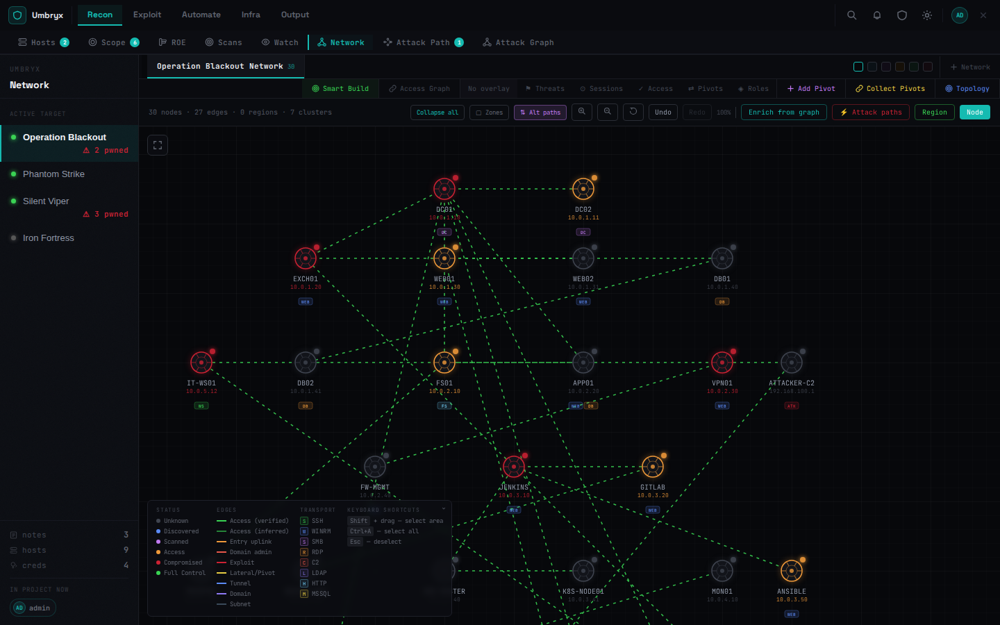
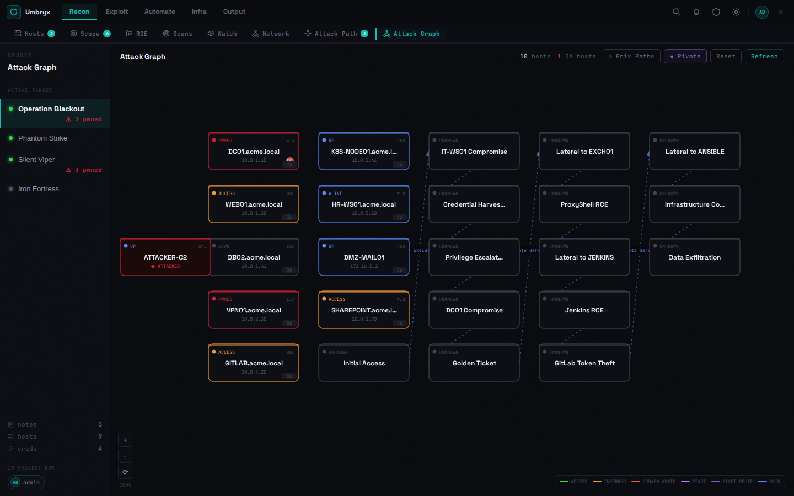
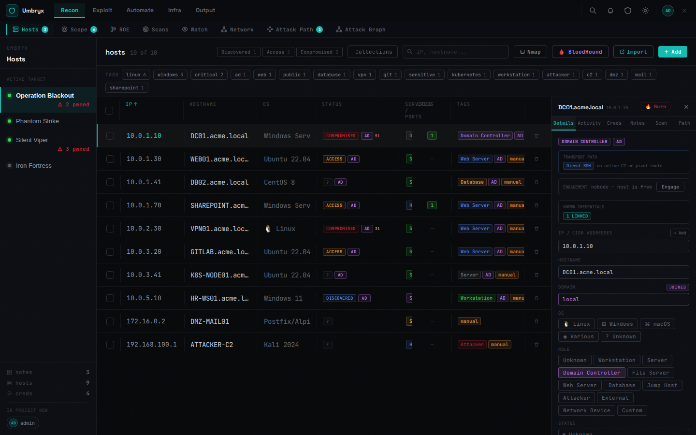
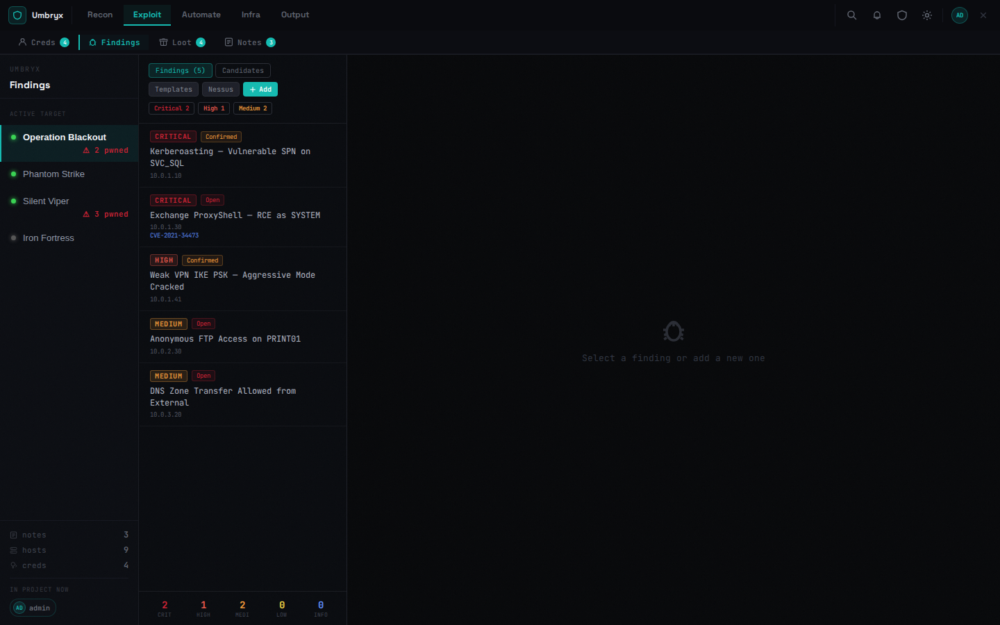

# Umbryx

> [!NOTE]
> Umbryx is developed with AI-assisted tooling. Every release passes an
> automated test suite and a security review before shipping.

Not a note-taking app. A platform where reconnaissance, operations,
evidence, and reporting live in one place — and feed each other:
scans create hosts, credential validation marks access edges, found
hashes become loot, and the report pulls from real data instead of
memory.




## Core capabilities

- **Orchestration** — run scans and tools on your own attacker machines over SSH (nmap, nuclei, NetExec, httpx, ffuf, DonPAPI); playbooks and scheduled automations repeat an engagement's sequence without retyping it
- **State tracking** — hosts, credentials (SMB/WinRM/SSH/LDAP/MSSQL/RDP validation), loot, findings, objectives and scope stay linked to what produced them
- **Intelligence** — the network map and attack graph infer pivot chains, privilege paths and Tier-0 targets from operational data, not from a diagram drawn once
- **C2 integrations** — Adaptix, Mythic, Sliver (Cobalt Strike via webhooks): agents sync, tasking runs from the platform, results land on the access graph
- **Evidence & reporting** — per-project encryption, loot tied to its source job, PDF/HTML/Markdown reports with the attack-path timeline built in
- **Workstation pool (Community form)** — register your own machines over SSH and grant/revoke per-user key access with a full audit trail
- **Platform Ops (Enterprise)** — infrastructure-as-catalog: C2+redirector stacks, pivot chains, DNS and VPN deploy and tear down with proof of deletion

## Editions

| | Community | Enterprise |
|---|---|---|
| Price | free (BSL 1.1 production grant, no license key) | per-instance license |
| Teams | up to 5 members | unlimited |
| Infra provisioning | bring your own machines | Hetzner/DO/Vultr → AWS/Azure/GCP/Proxmox |
| SSO (OIDC), multi-org, HA, air-gap | — | ✓ |

Full comparison: [EDITIONS.md](EDITIONS.md).




## Quick start

```bash
git clone https://github.com/Umbryx-Project/umbryx-core.git
cd umbryx-core
./install.sh
```

The interactive wizard asks for the essentials, generates all secrets
(`JWT_SECRET`, a Fernet `ENCRYPTION_KEY`, DB credentials), offers TLS
modes, builds the images, starts the stack and waits for the health
check. `UMBRYX_INSTALL_NO_TUI=1` for plain-text prompts, `--dry-run`
to preview every command.

Requirements: Linux with Docker + the compose plugin. Updating an
existing install is `./update.sh` (backups + rollback included).
Manual setup walkthrough: [docs](https://docs.umbryx.pro).

## Documentation

- **[docs.umbryx.pro](https://docs.umbryx.pro)** — getting started, user guide, administration, security design

## Deployment note

Umbryx is designed for **internal, trusted networks** — VPN, air-gapped
lab, jump host. Do not expose it directly to the internet; put remote
access behind a VPN or a reverse proxy with mTLS.

## License

Business Source License 1.1 (Licensor: Umbryx Project) — the
Additional Use Grant permits production use of Umbryx Core, including
inside a commercial organization and for paid security assessments you
perform for clients. Not a hosted/managed service of the Licensed
Work. Change Date: 2030-05-30 → Apache 2.0. See [LICENSE](LICENSE).

